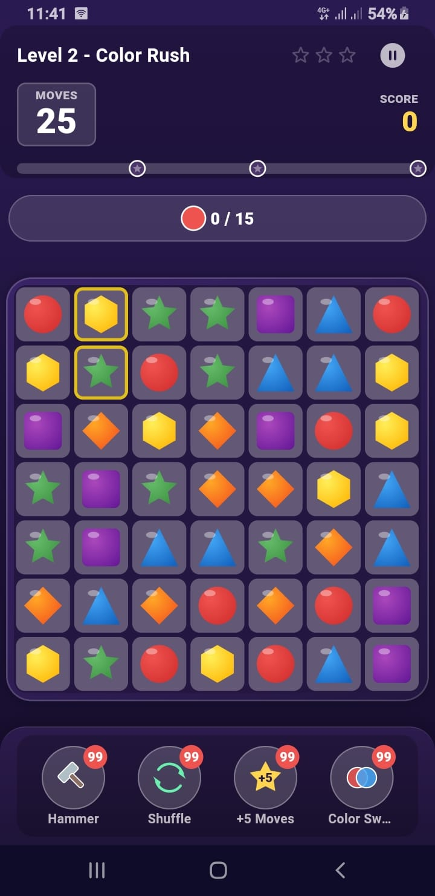

# 💎 Match-3 Puzzle Blitz

A polished **Match-3 puzzle game** built with **Flutter**, featuring a pure-Dart game engine, clean architecture, Riverpod state management, and a full meta-game (levels, lives, boosters, daily rewards, shop(Dummy).

---

## 🎬 App Demo

  

*Click the screenshot above to watch the app in action on YouTube.*

---

## ✨ Features

### Gameplay
- **8×8 board** (configurable 6–10 rows/cols) with 4–6 gem colors
- **Cascade engine** with chain-combo multipliers (up to 5×)
- **Special gems**: Striped (H/V), Wrapped, and Color Bomb
- **Special combos**: swap two specials for large board-clearing explosions
- **Smart hint system** (idle hint after 5 seconds)
- **Deadlock detection** with automatic board shuffle
- **Obstacles**: rock, wood, crate, plus jelly cells and blocked cells

### Level System
- **50 handcrafted levels** with multiple goal types:
  - 🎯 Target Score
  - 💎 Collect Pieces
  - 🍮 Clear All Jelly
  - 🍒 Drop Ingredients
- 3-star rating system and per-level progress tracking

### Meta Game
- ❤️ **Lives system** with timed regeneration (max 5, 1 life / 30 min)
- 🔨 **Boosters**: Hammer, Shuffle, +5 Moves, Color Swap
- 🎁 **Daily rewards** with streak tracking
- 🛒 **Shop** (Dummy) with coin balance and IAP-ready architecture
- ⚙️ **Settings**: sound, music, haptics
- 🌐 Centralized localization strings

### UI / Visuals
- Gems rendered with **CustomPainter** (no image assets needed)
- Particle effects, animated swaps, falls, and clears
- Design tokens + centralized theme

### Audio
- Sound effects are **dummy placeholder sounds generated with Python** (not professionally produced audio)
- Replace them with your own sound files.

---

### Tech Stack

| Area | Package |
|------|---------|
| State management / DI | `flutter_riverpod` |
| Local persistence | `shared_preferences` |
| Ads | `google_mobile_ads` |
| Audio | `audioplayers` |
| Utilities | `collection` |

---

## 📱 Tested Platforms

| Platform | Status |
|----------|--------|
| Android | ✅ Tested |
| Web | ✅ Tested (ads disabled via no-op service) |
| iOS | ⚠️ Not tested |

> Target: Android

---

## 🚀 Getting Started

### Prerequisites
- Flutter SDK 3.x+
- Dart SDK 3.x+
- Android Studio / VS Code

---

## 🧪 Customization

- **Add levels:** edit `lib/features/levels/data/level_definitions.dart`
- **Change gem colors:** edit `lib/core/theme/gem_palette.dart`
- **Tweak difficulty/scoring:** edit `lib/core/constants/game_config.dart`
- **Change sounds:** replace the dummy audio files (see Audio Assets)
- **Add a language:** extend `lib/core/localization/app_strings.dart`
